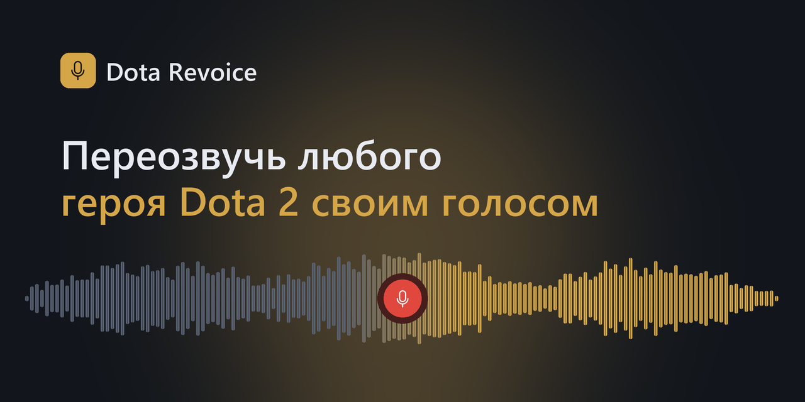
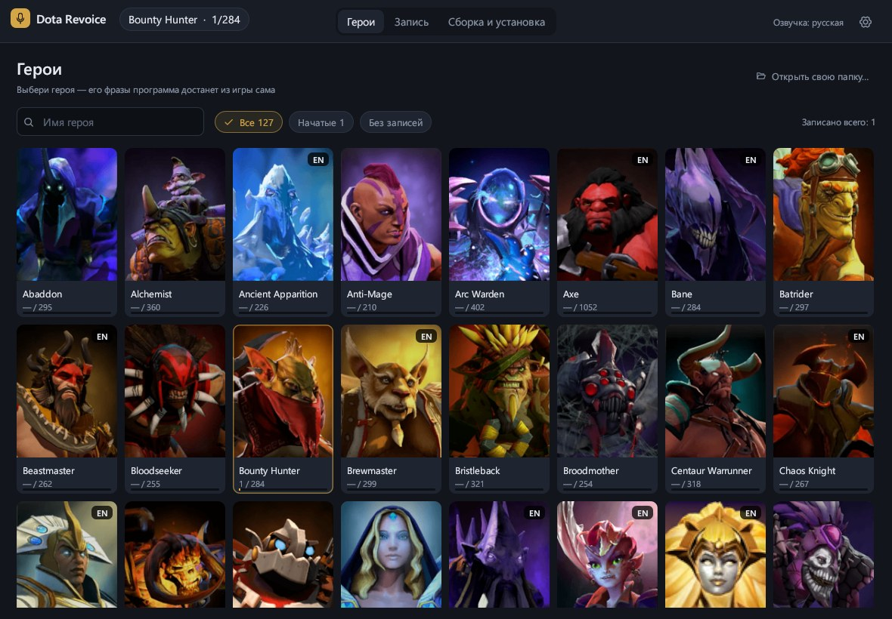

<p align="center">
  
</p>

<p align="center">
  <b>English</b> | <a href="README.md">Русский</a>
</p>

<p align="center">
  <a href="https://github.com/BasteArima/dota-revoice/actions/workflows/ci.yml"></a>
  <a href="https://github.com/BasteArima/dota-revoice/releases/latest"></a>
  <a href="LICENSE"></a>
  
</p>

# Dota Revoice

An app for amateur re-voicing of Dota 2 heroes. Listen to the original line, record
your own (or drop in a file — even a Telegram voice message), and the app builds a mod
that the game loads instead of Valve's voice-over.

- every Dota hero with portraits — the app extracts the lines from the game itself, no Source 2 Viewer needed;
- a hero's lines grouped by category, with search and notes on lines;
- waveforms of the original and your version on the same scale, "original → mine" comparison;
- microphone recording: a 3-2-1 countdown or "listen to the original first";
- silence trimming (automatic or by hand on the waveform), loudness matched to the original (LUFS) —
  for one line or for all of the hero's lines at once, a loudness slider, noise reduction, voice pitch,
  takes — all lossless, the source recording is never changed;
- building the pack, installing it into the game and launching Dota in three steps; the mod
  can be turned off and back on with a single switch, no rebuild needed;
- settings: where the game is, which voice-over you're replacing, where files are stored;
- Russian and English interface (switch it in Settings);
- sharing lines with friends as a single zip file.

## Screenshots

*The screenshots show the Russian interface; the English one has the same layout.*




> A fan project, not affiliated with Valve. The app only changes files in the voice-over
> language folder (`game/dota_russian` etc.) and can undo everything it does.

## Download

Ready-made builds are on the [Releases](https://github.com/BasteArima/dota-revoice/releases) page.

**Windows.** Unpack `DotaRevoice-…-windows-x64.zip` and run `DotaRevoice.exe`.
The app isn't signed with a certificate, so Windows may show "Windows protected your PC" —
click "More info" → "Run anyway".

**macOS.** Unpack `DotaRevoice-…-macos.zip` and drag `DotaRevoice.app` into Applications.
On first launch: right-click the app → "Open" → "Open" (it has no Apple certificate
either). When it asks for microphone access, allow it.

**Linux.** Unpack `DotaRevoice-…-linux-x64.tar.gz` and run `./dota-revoice`.
It needs ALSA (`libasound2`) — a regular desktop already has it; PipeWire and PulseAudio
work through it. Both regular and Flatpak Steam are detected. For the application menu
there's a `dota-revoice.desktop` next to the binary — fix the path in it and put it into
`~/.local/share/applications/`.

On first launch the app asks three things: where Dota is (it usually finds it by itself),
which voice-over you're replacing (the languages downloaded in Steam are listed) and where
to keep your lines. By default that's the `library` folder next to the app on Windows and
"Documents/Dota Revoice" on macOS and Linux. All of this can be changed later in Settings
(the gear at the top right), including the interface language.

The app checks for new versions by itself: a "Version … is out" banner with a link appears at the top.

## How to use

1. **Pick a hero** on the **Heroes** tab. The app extracts the hero's lines from the game's
   voice-over pack (into the workspace folder, `originals/`). Heroes marked "EN" have no
   voice-over in the selected language — their original is English, and your lines will
   replace it in the game. Sounds that aren't in the list (announcers, couriers, your own
   export) — "Open my own folder…".
2. **Record.** Pick a line, listen to the original (Space), press R or the big red button,
   say the line, press R again. Silence at the edges and loudness are adjusted automatically.
3. **Build & install** → **Build the pack** → **Install** (close Dota first) →
   **Launch Dota**. Your new lines play in the game.

### Hotkeys

| Key | Action |
|---|---|
| Space | original |
| Ctrl+Space | my version |
| R | record / stop |
| C | compare: the original, then mine |
| T | trim silence at the edges |
| L | loudness like the original |
| ↑ ↓ | previous / next line |
| N | next unrecorded line |
| Del | move my version to the trash |
| Esc | cancel recording, stop playback |

### Share with friends

**Build & install** → **Share with friends**:

- **Export bundle…** — all your lines for all heroes (and notes) in one zip.
- **Import bundle…** — adds a friend's lines. Your versions are left alone unless you turn on
  "replace my versions"; then yours goes into takes and can be brought back.

After importing, rebuild and install the pack.

### Turning the mod off or removing it

**Build & install** → **Install into the game**:

- the **My voice-over / Valve voice-over** switch — the disabled pack stays in the game
  (`pak02_dir.vpk.off`) and turns back on instantly, no rebuild needed;
- **Remove from game** — the app deletes its pack and brings back Valve's voice-over. Steam's
  "Verify integrity of game files" does the same.

## How it works

The voice-over lives in `game/dota_<language>/pak01_dir.vpk` (+ the `pak01_000…` volumes).
Within one folder the game reads packs in numeric order, so `pak01` would override any mod.
The app builds `pak02_dir.vpk` — all of Valve's voice-over plus your lines — and renames
`pak01_dir.vpk` to `pak01_dir.vpk.off`. The `pak01_00N.vpk` volumes are left untouched.

If Steam brings back `pak01_dir.vpk` after an update, the app shows a warning and offers
to reinstall. The language folder is picked by the game's voice-over setting: with English
voice-over, mods from a language folder don't load — the app warns about that too.

## Building from source

You need [Rust](https://rustup.rs/) (stable). On macOS also the Xcode Command Line Tools,
on Linux `libasound2-dev` and `pkg-config` (Debian/Ubuntu: `sudo apt install libasound2-dev pkg-config`).

```bash
cargo run --release
```

Tests: `cargo test`. Details on how the code is organized are in [AGENTS.md](AGENTS.md) (in Russian).

## License

Dota Revoice is distributed under the [GNU GPL v3](LICENSE): you're free to use, study,
change and share the app, but modified versions must stay open under GPL v3 as well.

## Third-party licenses

| Component | Purpose | License |
|---|---|---|
| [LAME](https://lame.sourceforge.io/) via `mp3lame-encoder` | mp3 encoding | LGPL (LAME — 2.0+, wrapper — 3.0) |
| [egui / eframe](https://github.com/emilk/egui) | interface | MIT / Apache-2.0 |
| [Phosphor Icons](https://phosphoricons.com/) via `egui-phosphor` | icons | MIT |
| [cpal](https://github.com/RustAudio/cpal) | audio: recording and playback | Apache-2.0 |
| [Symphonia](https://github.com/pdeljanov/Symphonia) | reading mp3/wav/ogg/flac/m4a | MPL-2.0 |
| [opus-decoder](https://crates.io/crates/opus-decoder), [ogg](https://crates.io/crates/ogg) | Telegram voice messages (Ogg Opus) | MIT / Apache-2.0, BSD-3-Clause |
| [nnnoiseless](https://github.com/jneem/nnnoiseless) (RNNoise) | noise reduction | BSD-3-Clause |
| [ebur128](https://github.com/sdroege/ebur128) | loudness in LUFS | MIT |
| [rubato](https://github.com/HEnquist/rubato) | resampling | MIT |
| [hound](https://github.com/ruuda/hound) | wav | Apache-2.0 |
| [zip](https://github.com/zip-rs/zip2), [ureq](https://github.com/algesten/ureq) | line bundles, update check | MIT, MIT / Apache-2.0 |
| [dirs](https://github.com/dirs-dev/dirs-rs) | the Documents folder | MIT / Apache-2.0 |
| [png](https://github.com/image-rs/image-png) | hero portraits | MIT / Apache-2.0 |
| [sys-locale](https://github.com/1Password/sys-locale) | system language on first launch | MIT / Apache-2.0 |

All of these licenses are compatible with GPL v3. LAME is linked into the app statically;
the app's source code is open, so it can be rebuilt with a different version of LAME —
as the LGPL requires.

The Dota 2 voice-over belongs to Valve; it isn't part of the repository and isn't shipped in releases.
