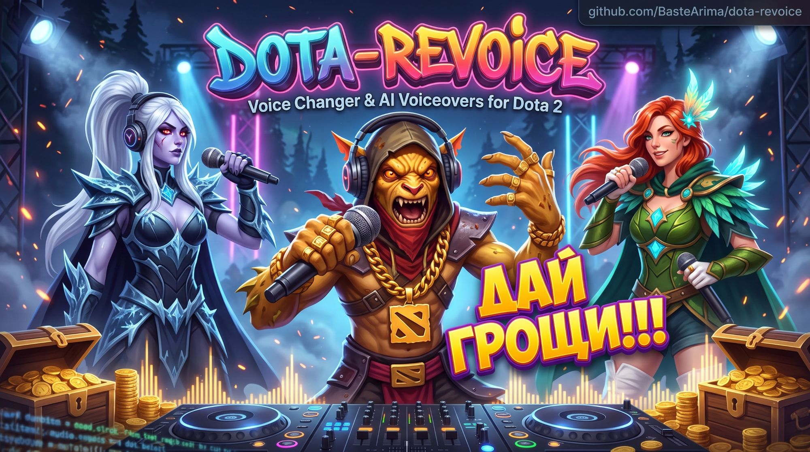
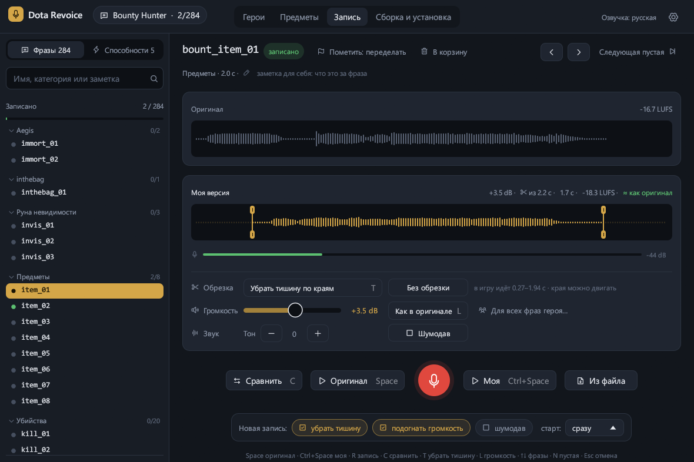
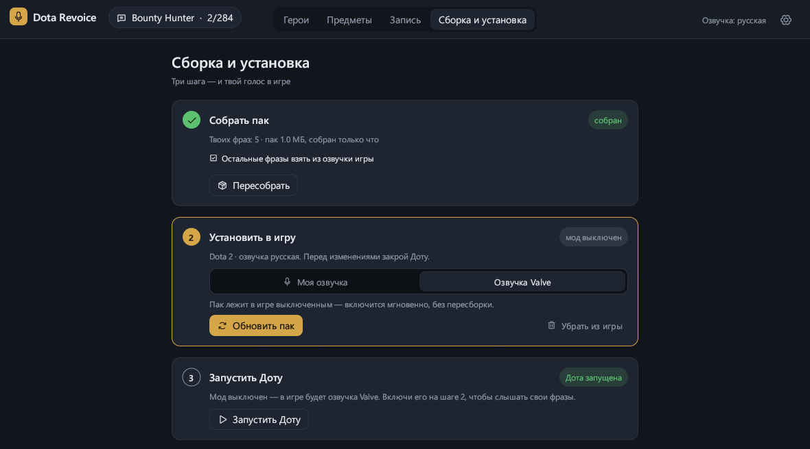

<p align="center">
  
</p>

<p align="center">
  <a href="https://github.com/BasteArima/dota-revoice/actions/workflows/ci.yml"></a>
  <a href="https://github.com/BasteArima/dota-revoice/releases/latest"></a>
  <a href="LICENSE"></a>
  
</p>

# Dota Revoice

Программа для любительской переозвучки героев Dota 2. Слушаешь оригинальную
реплику, записываешь свою (или подкладываешь файл — хоть голосовое из Telegram),
а программа собирает из этого мод, который игра подхватывает вместо озвучки Valve.

- список фраз героя по категориям, поиск, заметки к фразам;
- волна оригинала и своей версии в одном масштабе, сравнение «оригинал → моя»;
- запись с микрофона: отсчёт 3-2-1 или «сначала прослушать оригинал»;
- обрезка тишины (сама или ручками на волне), громкость как в оригинале (LUFS),
  шумодав, тон голоса, дубли — всё без потерь, исходник не меняется;
- сборка пака, установка в игру, откат и запуск Доты — в три шага;
- обмен фразами с друзьями одним zip-файлом.

## Как это выглядит





> Фанатский проект, не связан с Valve. Программа меняет только файлы в папке
> языка озвучки (`game/dota_russian` и т.п.) и всё умеет откатывать.

## Скачать

Готовые сборки — на странице [Releases](https://github.com/BasteArima/dota-revoice/releases).

**Windows.** Распакуй `DotaRevoice-…-windows-x64.zip` и запусти `DotaRevoice.exe`.
Программа не подписана сертификатом, поэтому Windows может показать «Система Windows
защитила ваш компьютер» — нажми «Подробнее» → «Выполнить в любом случае».

**macOS.** Распакуй `DotaRevoice-…-macos.zip` и перетащи `DotaRevoice.app` в «Программы».
При первом запуске: правый клик по программе → «Открыть» → «Открыть» (она тоже без
сертификата Apple). Когда попросит доступ к микрофону — разреши.

**Linux.** Распакуй `DotaRevoice-…-linux-x64.tar.gz` и запусти `./dota-revoice`.
Нужна ALSA (`libasound2`) — на обычном десктопе она уже есть; PipeWire и PulseAudio
работают через неё. Steam находится и обычный, и из Flatpak. Для меню приложений
рядом лежит `dota-revoice.desktop` — поправь в нём путь и положи в
`~/.local/share/applications/`.

Новые версии программа находит сама: сверху появится «Вышла новая версия» со ссылкой.

## Как пользоваться

1. **Выгрузи фразы героя.** Открой в [Source 2 Viewer](https://valveresourceformat.github.io/)
   пак озвучки — `…/dota 2 beta/game/dota_russian/pak01_dir.vpk` (для английской —
   `game/dota/pak01_dir.vpk`), найди `sounds/vo/<герой>` и выгрузи папку целиком.
   Получится что-то вроде `D:/vo/sounds/vo/bounty_hunter/*.mp3`.
2. **Открой эту папку в программе** («Открыть папку» вверху). Свои фразы программа
   кладёт рядом, в `D:/vo/export/`, под теми же именами.
3. **Записывай.** Выбери фразу, послушай оригинал (Space), нажми R или большую красную
   кнопку, скажи реплику, снова R. Тишина по краям и громкость подгонятся сами.
4. **«Сборка и установка»** → «Собрать пак» → «Установить» (Доту перед этим закрой) →
   «Запустить Доту». Новые фразы звучат в игре.

### Горячие клавиши

| Клавиша | Что делает |
|---|---|
| Space | оригинал |
| Ctrl+Space | моя версия |
| R | запись / стоп |
| C | сравнить: оригинал, потом моя |
| T | убрать тишину по краям |
| L | громкость как в оригинале |
| ↑ ↓ | предыдущая / следующая фраза |
| N | следующая незаписанная |
| Del | моя версия — в корзину |
| Esc | отменить запись, остановить звук |

### Обмен с друзьями

«Сборка и установка» → «Обмен с друзьями»:

- **Экспорт пачки** — все твои фразы всех героев (и заметки) в один zip.
- **Импорт пачки** — добавляет фразы друга. Твои версии не трогаются, пока не включишь
  «заменять мои версии»; тогда твоя уходит в дубли, и её можно вернуть.

После импорта пересобери и установи пак.

### Откатить всё

«Сборка и установка» → «Установить в игру» → «Откатить»: программа уберёт свой пак и
вернёт озвучку Valve. То же самое делает «Проверить целостность файлов» в Steam.

## Как это работает

Озвучка лежит в `game/dota_<язык>/pak01_dir.vpk` (+ тома `pak01_000…`). Внутри одной папки
игра читает паки по порядку номеров, поэтому `pak01` перекрыл бы любой мод. Программа
собирает `pak02_dir.vpk` — вся озвучка Valve плюс твои фразы — и переименовывает
`pak01_dir.vpk` в `pak01_dir.vpk.off`. Тома `pak01_00N.vpk` не трогаются.

Если Steam после обновления вернёт `pak01_dir.vpk`, программа покажет предупреждение
и предложит переустановить. Папку языка выбирает настройка озвучки игры: с английской
озвучкой моды из папки языка не загружаются — программа об этом тоже предупредит.

## Сборка из исходников

Нужен [Rust](https://rustup.rs/) (stable). На macOS — ещё Xcode Command Line Tools,
на Linux — `libasound2-dev` и `pkg-config` (Debian/Ubuntu: `sudo apt install libasound2-dev pkg-config`).

```bash
cargo run --release
```

Тесты: `cargo test`. Подробности об устройстве кода — в [AGENTS.md](AGENTS.md).

## Лицензия

Dota Revoice распространяется по лицензии [GNU GPL v3](LICENSE): программу можно
свободно использовать, изучать, менять и распространять, но изменённые версии тоже
должны оставаться открытыми под GPL v3.

## Лицензии сторонних компонентов

| Компонент | Зачем | Лицензия |
|---|---|---|
| [LAME](https://lame.sourceforge.io/) через `mp3lame-encoder` | кодирование mp3 | LGPL (LAME — 2.0+, обёртка — 3.0) |
| [egui / eframe](https://github.com/emilk/egui) | интерфейс | MIT / Apache-2.0 |
| [Phosphor Icons](https://phosphoricons.com/) через `egui-phosphor` | иконки | MIT |
| [cpal](https://github.com/RustAudio/cpal) | звук: запись и воспроизведение | Apache-2.0 |
| [Symphonia](https://github.com/pdeljanov/Symphonia) | чтение mp3/wav/ogg/flac/m4a | MPL-2.0 |
| [opus-decoder](https://crates.io/crates/opus-decoder), [ogg](https://crates.io/crates/ogg) | голосовые Telegram (Ogg Opus) | MIT / Apache-2.0, BSD-3-Clause |
| [nnnoiseless](https://github.com/jneem/nnnoiseless) (RNNoise) | шумодав | BSD-3-Clause |
| [ebur128](https://github.com/sdroege/ebur128) | громкость в LUFS | MIT |
| [rubato](https://github.com/HEnquist/rubato) | ресемплинг | MIT |
| [hound](https://github.com/ruuda/hound) | wav | Apache-2.0 |
| [zip](https://github.com/zip-rs/zip2), [ureq](https://github.com/algesten/ureq) | пачки фраз, проверка обновлений | MIT, MIT / Apache-2.0 |

Все эти лицензии совместимы с GPL v3. LAME собирается в программу статически;
исходный код программы открыт, поэтому её можно пересобрать с другой версией LAME —
этого требует LGPL.

Озвучка Dota 2 принадлежит Valve; в репозиторий она не входит и в релизы не попадает.
